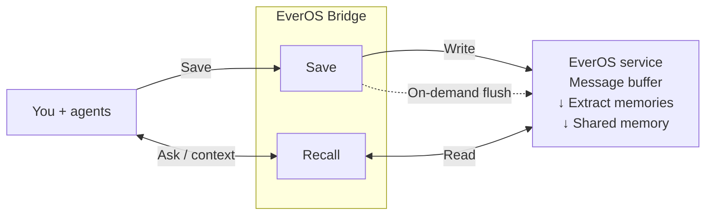

# EverOS Bridge

**Memory that follows you across coding agents.**

[](https://github.com/namelessssssssssss/everos-bridge/actions/workflows/tests.yml)
[](https://github.com/namelessssssssssss/everos-bridge/actions/workflows/windows.yml)

English · [简体中文](README.zh-CN.md)

**Get connected in two steps**

1. **Provide your EverOS API key and user ID** through environment variables or local configuration available to your agent.
2. **Give [this repository link](https://github.com/namelessssssssssss/everos-bridge) to your agent** and ask it to follow `AGENTS.md` to complete setup.

Keep your preferences, project decisions, and troubleshooting experience available when you start a new chat, switch agents, or move to another device. EverOS Bridge connects Claude Code, Codex, Kimi, and other assistants to the same personal memory, so you spend less time explaining what came before.

[EverOS](https://docs.evermind.ai/cloud/quickstart) stores and retrieves memories from your conversations. **Bridge brings that memory into the agents you already use**, with automatic recall and capture where supported, plus tools your agent can use to save decisions and look up past work.

[Agent setup](#set-up-with-your-agent) · [Why use it](#pick-up-where-you-left-off) · [How it works](#the-memory-loop) · [Supported agents](#supported-agents) · [Get started](#get-started) · [Usage guide](docs/usage.md)

## Set up with your agent

Give your agent the repository link and a setup request. The [agent entry](AGENTS.en.md) guides it through checking the existing environment, previewing changes, installing, and verifying the result. `AGENTS.md` remains the canonical file that agents discover; the English companion carries the same instructions.

> Read https://github.com/namelessssssssssss/everos-bridge and follow AGENTS.md (English companion: AGENTS.en.md) to set up EverOS for the supported agents on this machine. Inspect and reuse the existing installation and configuration first, then verify setup without exposing credentials.

With only a repository URL and no setup authorization, the entry starts with a read-only preflight and a concrete next step.

## Pick up where you left off

### Carry decisions into your next session

You discussed a design in Claude Code and are now implementing it in Codex. Ask, “What did we decide about retries, and why?” Your new agent can retrieve the saved decision and its rationale from the same memory space.

### Reuse what you learned solving a problem

When a familiar failure returns, ask, “Have we seen this timeout before? What did we try?” Save the steps, failed attempts, and outcome of a debugging session so that experience is available to future work.

### Keep your working preferences across tools

Record how you want code reviewed, which tradeoffs matter to you, or how you prefer explanations. Connected agents can retrieve those preferences in later sessions. When a preference changes, ask your agent to update it.

Memory supplies context; your agent still needs the relevant files, permissions, and current project instructions to do the work.

## How it fits into your day

1. **Work in your usual agent.** With automatic capture enabled, user and assistant conversation text is saved as you work. You can also ask your agent to remember an important decision or record a useful troubleshooting process.
2. **Bring relevant history into the next question.** Automatic integrations retrieve memories before each prompt. In other clients, the agent follows its memory instructions or your request to search.
3. **Continue across sessions and devices.** Connect another supported agent to the same EverOS service, account, and user ID to retrieve those memories there. New memories become searchable after the service processes them.

### The memory loop

Bridge runs alongside each connected agent. It sends captured conversation text and explicit memory records to EverOS, then brings relevant history back into later conversations.



- **Save:** automatic capture is available only in supported agents; explicit memory tools save decisions and troubleshooting experience. A confirmed write means the service accepted the messages.
- **Process:** v2 extraction is handled by the service, or requested explicitly when the agent needs it. Bridge does not flush v2 after every write. EverOS Cloud also processes sessions after two hours without new messages; extraction and search visibility can take time.
- **Recall:** profile information and memories relevant to the current question return through Bridge to the agent. Other connected agents can query the same memory using the same service, account, and user ID; project files stay in their own workspaces.

## Supported agents

| Agent | Recall and capture experience |
| --- | --- |
| Claude Code · Codex CLI / App | Automatic recall and conversation capture |
| Kimi Code · Kimi Work desktop | Automatic recall and conversation capture |
| MiMoCode · MiMo Desktop | Automatic recall and conversation capture |
| TraeX ≥ 0.209.1 | Automatic recall and conversation capture |
| Claude Code on the web | Automatic recall and capture after [cloud setup](docs/usage.md#claude-code-on-the-web) |
| Cursor · Claude Desktop / Cowork · Gemini CLI · legacy Coco | Recall and explicit saves through agent tools; no automatic conversation capture |
| Doubao Work cloud | Recall and capture through an agent-followed skill; no automatic hooks |

Automatic features require the integration to be loaded and any required hooks to be trusted. On native Windows, the installer supports **Codex** and **Kimi Work desktop**. See [host setup notes](docs/usage.md#host-specific-setup) for platform and version details.

## Get started

You need **Python 3.9+**, **Git**, and an [EverOS Cloud account and API key](https://docs.evermind.ai/cloud/quickstart). Choose a user ID for your personal memory space and reuse it across your connected agents and devices. EverOS service quotas apply.

Conversation capture sends text to your configured EverOS service. See [Your memory and controls](#your-memory-and-controls) for what is stored and how to pause writes.

### macOS / Linux

```bash
git clone https://github.com/namelessssssssssss/everos-bridge.git ~/.everos-bridge
cd ~/.everos-bridge
./install.sh --dry-run   # Preview which agents will be configured
./install.sh
```

Enter your user ID and API key when prompted. The installer configures detected agents, backs up their existing settings, and checks connectivity. No additional Python packages are required.

### Windows

Run in PowerShell for Codex:

```powershell
git clone https://github.com/namelessssssssssss/everos-bridge.git "$env:USERPROFILE\.everos-bridge"
Set-Location "$env:USERPROFILE\.everos-bridge"
.\install.ps1 -DryRun
.\install.ps1
```

For Kimi Work desktop, add `-KimiDesktop` to both installer commands. See the [Windows guide](docs/windows-integration.md) (Chinese) for interpreter selection and setup details.

### Try your first memory

Open a new agent session after installation and review any hook trust prompts. Then try a small project decision:

> Remember this in EverOS: For the sample billing service, we decided to retry only idempotent requests, because retrying a payment could charge a customer twice.

Wait for the agent to confirm the memory was saved. Open a **new chat**, or another configured agent using the same memory space, and ask:

> Search EverOS for the retry decision we made for the sample billing service. What did we decide, and why?

Check that the retrieved memory includes both the decision and the reason. If it is not available yet, allow time for processing and retry. The [troubleshooting guide](docs/usage.md#troubleshooting) explains how to check writes, recall, and connectivity.

## Your memory and controls

- **Storage:** conversation text and explicit memory records are sent to your configured EverOS service, which defaults to EverOS Cloud. Bridge also synchronizes Claude Code's local memory files. Credentials and operational state stay outside the repository.
- **Pause saving:** add the unquoted line `EVEROS_WRITE=0` to `~/.everos/config.env` to stop Bridge writes, including automatic capture and explicit saves. You can still search existing memories.
- **Control automatic recall:** add `EVEROS_INJECT=0` to the same file to stop automatic memory injection while keeping manual search available.
- **Keep context current:** ask your agent to correct outdated profile information or record a changed decision. Retrieved memories describe past work; verify them against today's code and requirements.

See the [configuration guide](docs/usage.md#configuration) for custom data locations and settings, and the [read/write protocol](PROTOCOL.md) (Chinese) for the full policy.

## Go further

| I want to… | Start here |
| --- | --- |
| Search memory from a terminal | [Terminal search](docs/usage.md#terminal-search) |
| Configure my agent or use a cloud workspace | [Host setup](docs/usage.md#host-specific-setup) |
| Update an installation | [Updates](docs/usage.md#updates) |
| Diagnose missing memories or quota errors | [Troubleshooting](docs/usage.md#troubleshooting) |
| Understand the available memory tools | [Agent tools](docs/usage.md#agent-tools) |
| Contribute a fix or another integration | [Development](docs/usage.md#development) · [Onboarding checklist](docs/agent-onboarding.md) (Chinese) |

The [Chinese version](README.zh-CN.md) covers the same content. For detailed background, see the [design notes](docs/methodology.md) and [EverOS service notes](docs/everos-notes.md) (Chinese).
