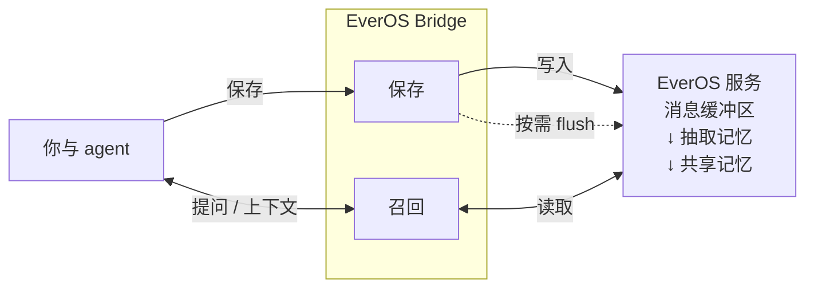

# EverOS Bridge

**让记忆随你在不同 coding agent 之间延续。**

[](https://github.com/namelessssssssssss/everos-bridge/actions/workflows/tests.yml)
[](https://github.com/namelessssssssssss/everos-bridge/actions/workflows/windows.yml)

[English](README.md) · 简体中文

**两步接入**

1. **提供 EverOS API key 和 user ID**，通过环境变量或本地配置供 Agent 使用。
2. **把[仓库链接](https://github.com/namelessssssssssss/everos-bridge)交给 Agent**，让它按 `AGENTS.md` 完成接入。

新开会话、更换 agent 或换一台设备时，仍能找回你的偏好、项目决策和排障经验。EverOS Bridge 将 Claude Code、Codex、Kimi 等助手接到同一份个人记忆，让你少花时间重复交代之前的背景。

[EverOS](https://docs.evermind.ai/cloud/quickstart) 保存和检索对话中形成的记忆。**Bridge 把这份记忆带进你已经在用的 agent**：在支持的宿主中自动召回和采集，也提供工具供 agent 保存决策、查询过去的工作。

[Agent 接入](#交给-agent-接入) · [为什么使用](#继续已有工作) · [原理与链路](#记忆如何形成闭环) · [支持的 agent](#支持的-agent) · [开始使用](#开始使用) · [使用指南](docs/usage.zh-CN.md)

## 交给 agent 接入

把仓库链接和接入要求交给 agent。[Agent 入口](AGENTS.md)会引导它检查已有环境、预览改动、安装并验证结果。`AGENTS.md` 保持为 agent 自动发现的规范文件，英文对应版提供相同指引。

> 阅读 https://github.com/namelessssssssssss/everos-bridge ，按 AGENTS.md 为这台机器上受支持的 agent 接入 EverOS。先检查并复用已有安装和配置，再完成验证，不要显示凭据。

如果只有仓库 URL、没有接入授权，入口会先完成只读预检并说明具体下一步。

## 继续已有工作

### 将决策带入下一次会话

你在 Claude Code 中讨论过一个设计，现在换到 Codex 实现。可以问：“之前关于重试是怎么决定的？为什么？”新 agent 能从同一记忆空间中检索已保存的决策及其理由。

### 复用解决问题的经验

再次遇到熟悉的故障时，可以问：“以前遇到过这个超时吗？当时试过什么？”保存一次排障的步骤、失败尝试和最终结果，让后续工作能够参考这段经验。

### 在不同工具中沿用工作偏好

记录你希望如何审查代码、看重哪些取舍，或偏好怎样的解释方式。接入的 agent 可以在后续会话中检索这些偏好；偏好变化时，让 agent 更新它。

记忆提供背景。要完成工作，agent 仍然需要相关文件、权限和当前项目指令。

## 融入日常工作

1. **继续使用熟悉的 agent。** 启用自动采集后，工作中的用户和助手对话文本会被保存。你也可以让 agent 记住重要决策，或记录有用的排障过程。
2. **把相关历史带进下一个问题。** 自动接入的宿主会在每次提问前检索记忆；其他客户端由 agent 按记忆指令或你的要求进行检索。
3. **在会话和设备之间延续。** 将另一个受支持的 agent 接到相同的 EverOS 服务、账号和用户 ID，即可在那里检索这些记忆。新记忆经过服务处理后才会出现在搜索结果中。

### 记忆如何形成闭环

Bridge 在每个已接入的 agent 一侧运行，将采集的对话文本和显式记忆记录发送给 EverOS，再把相关历史带回后续对话。



- **保存：**只有受支持的 agent 提供自动采集；也可以通过记忆工具显式保存决策和排障经验。确认写入表示服务端已接受消息。
- **处理：**v2 默认由服务端处理抽取，也可由 agent 在有需要时显式请求；Bridge 不在每次 v2 写入后 flush。EverOS Cloud 还会在两小时没有新消息后处理会话；抽取和搜索可见性可能需要时间。
- **召回：**画像信息和与当前问题相关的记忆经 Bridge 返回 agent。其他已接入的 agent 使用相同的服务、账号和用户 ID，即可查询同一份记忆；项目文件仍保留在各自工作区。

## 支持的 agent

| Agent | 召回与采集体验 |
| --- | --- |
| Claude Code · Codex CLI / App | 自动召回与对话采集 |
| Google Antigravity | 自动召回与对话采集 |
| Kimi Code · Kimi Work 桌面端 | 自动召回与对话采集 |
| MiMoCode · MiMo Desktop | 自动召回与对话采集 |
| TraeX ≥ 0.209.1 | 自动召回与对话采集 |
| Claude Code on the web | 完成[云端接入](docs/usage.zh-CN.md#claude-code-on-the-web)后自动召回与采集 |
| Cursor · Claude Desktop / Cowork · Gemini CLI · 旧版 Coco | 通过 agent 工具召回和显式保存；没有自动对话采集 |
| Doubao Work 云端 | agent 按 skill 执行召回与采集；没有自动 hook |

自动能力需要接入已加载，并信任宿主要求授权的 hook。原生 Windows 安装器支持 **Codex** 和 **Kimi Work 桌面端**。平台与版本细节见[各宿主接入说明](docs/usage.zh-CN.md#各宿主接入)。

## 开始使用

你需要 **Python 3.9+**、**Git**，以及 [EverOS Cloud 账号和 API key](https://docs.evermind.ai/cloud/quickstart)。为个人记忆空间选择一个用户 ID，在接入的 agent 和设备上使用同一个 ID。使用时受 EverOS 服务配额约束。

对话采集会把文本发送到你配置的 EverOS 服务。保存范围和暂停写入的方法见[记忆与控制](#记忆与控制)。

### macOS / Linux

```bash
git clone https://github.com/namelessssssssssss/everos-bridge.git ~/.everos-bridge
cd ~/.everos-bridge
./install.sh --dry-run   # Preview which agents will be configured
./install.sh
```

按提示输入用户 ID 和 API key。安装器会配置检测到的 agent，先备份既有设置，再检查连通性。无需安装额外的 Python 包。

### Windows

在 PowerShell 中为 Codex 执行：

```powershell
git clone https://github.com/namelessssssssssss/everos-bridge.git "$env:USERPROFILE\.everos-bridge"
Set-Location "$env:USERPROFILE\.everos-bridge"
.\install.ps1 -DryRun
.\install.ps1
```

接入 Kimi Work 桌面端时，为两条安装命令都加上 `-KimiDesktop`。解释器选择和接入细节见 [Windows 指南](docs/windows-integration.md)（中文）。

### 体验第一条记忆

安装后新开一个 agent 会话，审阅宿主弹出的 hook 信任提示。然后尝试保存一条简单的项目决策：

> 请在 EverOS 中记住：示例计费服务只重试幂等请求，因为重试一次支付可能导致客户被重复扣款。

等待 agent 确认记忆已保存。打开一个**新会话**，或使用同一记忆空间的另一个已接入 agent，然后问：

> 请在 EverOS 中检索示例计费服务的重试决策。我们决定了什么？为什么？

检查检索结果是否同时包含决策和理由。暂时查不到时，可以等待服务处理后再试。[排查指南](docs/usage.zh-CN.md#排查问题)介绍了如何检查写入、召回和连通性。

## 记忆与控制

- **保存位置：**对话文本和显式记忆记录会发送到配置的 EverOS 服务，默认是 EverOS Cloud。Bridge 也会同步 Claude Code 的本地记忆文件。凭据和运行状态保存在仓库之外。
- **暂停保存：**在 `~/.everos/config.env` 中加入不带引号的 `EVEROS_WRITE=0`，停止 Bridge 的写入，包括自动采集和显式保存。仍可搜索已有记忆。
- **控制自动召回：**在同一文件中加入 `EVEROS_INJECT=0`，停止自动注入记忆，同时保留手动检索能力。
- **保持信息准确：**让 agent 修正过时的画像信息，或记录已改变的决策。检索到的记忆描述的是过去的工作，应结合今天的代码和需求核实。

自定义数据目录和设置见[配置指南](docs/usage.zh-CN.md#配置)，完整规则见[读写协议](PROTOCOL.md)（中文）。

## 继续探索

| 我想要…… | 从这里开始 |
| --- | --- |
| 在终端中搜索记忆 | [终端检索](docs/usage.zh-CN.md#终端检索) |
| 配置 agent 或使用云端工作区 | [各宿主接入](docs/usage.zh-CN.md#各宿主接入) |
| 更新已有安装 | [更新](docs/usage.zh-CN.md#更新) |
| 排查记忆缺失或配额错误 | [排查问题](docs/usage.zh-CN.md#排查问题) |
| 了解可用的记忆工具 | [记忆工具](docs/usage.zh-CN.md#记忆工具) |
| 贡献修复或新的接入 | [开发维护](docs/usage.zh-CN.md#开发维护) · [接入清单](docs/agent-onboarding.md)（中文） |

[英文版](README.md)涵盖相同内容。详细背景见[设计说明](docs/methodology.md)和 [EverOS 服务说明](docs/everos-notes.md)（中文）。
